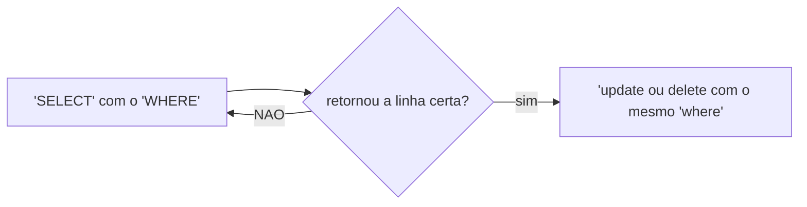

# aula 05

- para filtrar colunas, utilizamos o comando:

```sql
SELECT nome,preço FROM produtos;
```

para filtro de produtos, utilizamos:

```sql

SELECT * FROM produtos WHERE estoque <  11; 

```

para ordenar os dados:

``` sql
SELECT nome,preço FROM produtos 

ORDER BY preço DESC;
```


**update** update ou delete sem um `WHERE` atinge TODAS as linhas nao existe ctrl + z 

Fluxo seguro (sempre):



atualizar:

```sql
 UPDATE maiorescidades
 SET populacao = '1000'
 WHERE nome='Tóquio';
 ```
redução dos valores
```sql

 SET populacao = populacao - 3
 WHERE nome = 'Tóquio';
 ```

delete:

```sql

DELETE FROM maiorescidades 
WHERE nome = 'Tóquio'
 ```

filtrando produtos que custam mais de 1000

```sql
SELECT nome,preco 
FROM produtos
WHERE preco > 1000;
```
