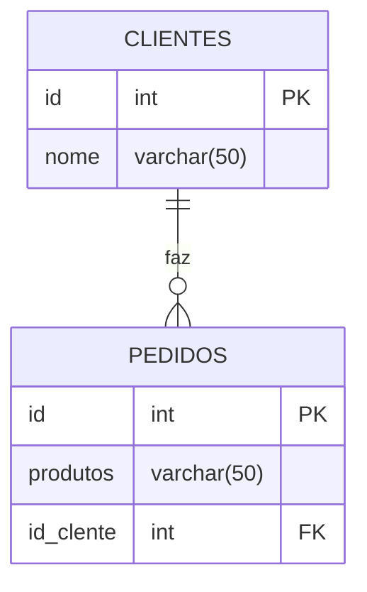

# aula 11

## relacionamento entre tabelas

- ideia principal: um cliente pode possuir varios pedidos.

## diagrama



1- criando tabela cliente
```sql
CREATE TABLE clientes(
    id SERIAL PRIMARY KEY,
    nome  VARCHAR(50) NOT NULL,
);
```

2- criamos a tabela pedidos, referenciando com a coluna ID da tabela clienes:

```sql
CREATE TABLE pedidos(
    id SERIAL PRIMARY KEY,
    produtos VARCHAR(50) NOT NULL,
    id_cliente INT REFERENCES clientes (id)
);
```

3- inserimos clientes

```sql

INSERT INTO clientes (nome) VALUES
('hannah'),
('miguel'),
('murilo'),
('lucas');
```

4- inserimos pedidos dos client4es:

```sql
INSERT INTO pedidos(produtos, id_cliente) VALUES 
('chocolate', 3),
('salgado', 1 ),
('refri', 2),
('chocolate',1) 
```

5- para verificar quais os produtos cada cliente comprou:

```sql
SELECT clientes.nome,pedidos.produtos
FROM pedidos
INNER JOIN clientes ON pedidos.id_cliente = clientes.id;
```
6- para verificar clientes que não compraram nada

```sql 
SELECT clientes.nome, pedidos.produtos
FROM clientes 
LEFT JOIN pedidos ON pedidos.id_cliente = clientes.id;
```

7- para representar somente quem não comprou nada: 

```sql
SELECT clientes.nome, pedidos.produtos
FROM clientes 
LEFT JOIN pedidos ON pedidos.id_cliente = clientes.id 
WHERE pedidos.id IS NULL;
```
